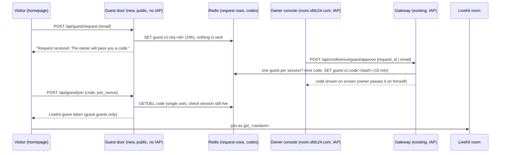

# Guest door for the Workshop conference: design (draft for review, no code)

Status: DESIGN ONLY. Written Sat 2026-10-24 00:40 ET by Grok Bot. No PRs, no deploys, nothing sent.
Grounded in: sfdc-24/conference main @5cca140 (read via `gh api`, not cloned), sfdc-24/sfdc24-site origin/main @d009c5e.

## 1. What the owner asked (Sat 00:14-00:17 ET)
> "users should be able to drop their email address [on the homepage] and get a code so they can join in conference, only upon my approval"
> "have it so that I can ask one more person to be in the conference with me"
> "my entry is with abdus@sfdc24.com"

## 2. Flow

## 3. Data (Redis, `guest:v1:` prefix, matching the chair's v1 colon-prefix rule in chair/conf_chair/redis_state.py)
| Key | Value | TTL |
|---|---|---|
| `guest:v1:req:<req_id>` | {email_lower, ts, ip_hash, status: pending/approved/declined} | 24 h |
| `guest:v1:req_by_email:<sha256(email)>` | req_id (dedupe) | 24 h |
| `guest:v1:code:<sha256(code)>` | {req_id, room, session_epoch} (code never stored in clear) | 15 min |
| `guest:v1:seat:<room>` | req_id (one human guest per session, SET NX) | until session deadline |
| `guest:v1:rl:ip:<ip_hash>` / `rl:email:<hash>` | counters | 1 h |
Redis is an ephemeral accelerator, not the system of record (same rule as redis_state.py). Approvals are also logged as ids only.

## 4. Routes and token grants
Existing (seen in gateway/conf_gateway/app.py): `POST /api/conference/join` -> `join()`; `guarded()` (JSON only, Origin in `config.public_origins`, `owners.verify()` from owner.py = IAP assertion + OWNER_EMAILS); `Nonces.use()` single-use join nonces (10 min, in-memory); `tokens.join_token()` (owner grants: mic + screen share, no data); `Signer` ES256.
New, owner side (inside the IAP gateway, behind `guarded()`):
- `POST /api/conference/guest/approve` {request_id} or {email} (owner-typed email = approval implied). Returns {code, expires_at}. Refuses if a seat is already held for the current `rooms.current()` session.
- `POST /api/conference/guest/revoke` {room, session_epoch}: frees the seat, kicks the guest identity.
New, public side (the guest cannot pass IAP, so these CANNOT live on the IAP service; see 9.3):
- `POST /api/guest/request` {email}: writes a request row only.
- `POST /api/guest/join` {code, join_nonce}: returns {livekit_url, room, identity, join_token, join_expires_at}. No broker token, no receipt, no session_epoch-bearing authority.
Guest LiveKit grants (new `tokens.guest_token()`): room_join for that one room, can_subscribe=True, can_publish=True with sources ["microphone"] only, can_publish_data=False, no screen share, identity `gst_<random>`, name "Guest", TTL = min(10 min join, session deadline). The guest hears and sees what is published (owner screen only if he shares); no canvas write (no broker/chalk scope), no Salesforce, no client data. Note: the canvas bucket file rooms/workshop.json is already public-read, so the canvas is not secret.

## 5. Abuse limits
- Request: 5/hour per IP hash, 3/day per email, max 50 pending rows; email syntax + length 254; honeypot field. No mail sent, so no spam relay.
- Approve: owner only (IAP); one seat per session (`SET NX`); a second approve returns 409 until revoke.
- Code: 8 chars from a 31-char alphabet (~40 bits), 15 min TTL, `GETDEL` = single use, 5 wrong tries per IP per 15 min then 429.
- Join: reuse the `Nonces` pattern for join_nonce; code bound to room + session_epoch, dies with the session (same "nothing outlives the session" rule as `tokens._until()`).
- `rooms.MAX_PARTICIPANTS = 4` (owner, chair, one reconnect each) must become 6 for owner + chair + guest + reconnects; chair must treat `gst_` as listener-speaker, never as owner (owner commands stay `conf.owner` packets from the server only).

## 6. Reuse vs new
Reuse: `guarded()`, `OwnerCheck`, `Nonces`, `Window` rate limiter, `rooms.current()`/`admission()` lock, `join_ttl()`, `_json()` no-store, the chair's Redis connection pattern (two switches CONF_REDIS_CONNECT / CONF_REDIS_ENABLED).
New: guest routes, `guest_token()`, Redis client in the gateway (gateway has no Redis today: requirements.txt has no redis package and deploy.sh sets no VPC egress), public guest-door service, homepage email field, console "Guests" panel (approve / show code / revoke), guest join page.

## 7. Files to touch
sfdc-24/conference: `gateway/conf_gateway/app.py` (approve/revoke routes + public routes behind a flag), new `gateway/conf_gateway/guests.py` (rows, codes, seat), `tokens.py` (`guest_token`), `rooms.py` (MAX_PARTICIPANTS), `main.py` (REDIS settings, GUEST_DOOR flag), `deploy.sh` (second service + room.sfdc24.com in PUBLIC_ORIGINS), `requirements.txt` (redis), `console/app.js` + `console/index.html` (Guests panel), chair (treat `gst_` identity), `docs/CONF-LINE-ARCHITECTURE.md` (has no guest rules today; add them).
sfdc-24/sfdc24-site: `index.html` (email field), new `assets/guest-request.js`, new `/conference/guest/` join page, `conference/index.html` + `CONFERENCES_BACKEND_NEEDS.md` (gate text changes from "closed until VERIFY and GO" only after owner GO), CSP connect-src for the door origin.

## 8. Tests to add
conference: `gateway/tests/test_guests.py`: request writes a row and sends nothing; non-owner approve 403; second approve 409; code single use (2nd join 409); expired code 410; code for old epoch refused; guest token grants (mic only, no data, no screen, one room, ttl <= deadline); rate limits 429; cross-origin refused. Add guest cases to `test_gateway_adversarial.py`.
site: update `tests/conferences_invite.spec.cjs` / `conferences_enter.spec.cjs` (today they assert NO invite and NO enter: `#conference-invite` count 0, `#conference-enter` count 0, contact text abdus@sfdc24.com) only after GO; new `tests/homepage_guest_request.spec.cjs`; keep `tests/test_conference_page.py` "Guests stay closed" until GO; 206,000-byte homepage budget must still pass (trim, never raise).

## 9. Open owner decisions
1. Code delivery: show code to owner (default, no new service) vs email it (needs a mail service = new spend/secret).
2. Guest-door hosting: Cloud Run IAP covers the whole `conference-gateway` service (`--iap --no-allow-unauthenticated`), so public routes need a second, unauthenticated Cloud Run service (or a public path in an existing non-IAP service). That is new IAM (allUsers invoker) and small spend, which the plan row said to avoid. He must pick.
3. Redis reach from the gateway (VPC egress) vs Firestore for rows (gateway already lives in a GCP project; chair uses Firestore checkpoints).
4. Gate text: when to replace "Guests stay closed until the owner records VERIFY and GO".
5. PR cap: sfdc24-site has 3 open (345, 357, 363), so no new site PR until one lands; sfdc-24/conference has 30 open PRs, far over cap; consolidate first.

## 10. Estimate
Gateway + guests.py + tests: ~1 day. Console panel: ~0.5 day. Site field + join page + specs: ~0.5 day. Guest-door service + IAM + origins deploy: ~0.5 day after decision 2. Reviews (Gemini design+code, Aya) + deploy by claude-mobile on PASS: ~0.5 day. Total ~3 working days.

## 11. Text invite and dial-out on the EXISTING rail (rev 2, Sat 2026-10-24 01:55 ET; owner ruling 01:31 ET: "we already got a canadian number and its all part of this project")

Design only; nothing sent, called, bought or moved. Rule: the owner sees the exact text or number and taps before anything leaves.

### What already exists (looked up on the Grok box, not asked)
- Telnyx account verified 2026-10-14; Canadian long-code number already used as Lou's sender (the Grok box's /workspace/telnyx/send_link.py `FROM`).
- Telnyx SIP trunk wired into LiveKit project p_3p1vbksold1 (SIP host 3p1vbksold1.sip.livekit.cloud). The outbound trunk id `ST_...` is used by /workspace/telnyx/lou_call.py, which placed the lou-outbound-* calls (CreateSIPParticipant with wait_until_answered).
- The locked SMS sender pattern: /workspace/telnyx/send_link.py. It sends only to allowlisted recipients, is a dry run by default, sends at most 1 per 180 s and 10 per ET day, and logs to logs/sms_log.jsonl. It calls POST https://api.telnyx.com/v2/messages with TELNYX_API_KEY read from env and never printed.
- WhatsApp through the existing Pipedream workflow (secret WA_PHONE_NUMBER_ID in sfdc24, per claude-mobile 05:35Z).

### Open fact (one yes/no for an agent with cloud access)
Is the conference gateway's LIVEKIT_URL on project p_3p1vbksold1? The two can share a project: the Grok box notes also name `blackboard-c5gn7crt.livekit.cloud`, and LiveKit Cloud shows a project's wss host and SIP host side by side on its settings page.
- **Same project:** no move. The gateway reuses the trunk id as a non-secret env var CONF_SIP_TRUNK_ID.
- **Different project:** the smaller path is one CreateSIPOutboundTrunk on the conference project, using the existing Telnyx SIP credentials (TELNYX_SIP_USER/PASS) and the existing number. Moving the conference instead would redeploy the gateway and chair with new LiveKit keys, so it is larger.

### Dial-out (claude-code-cli builds console/ + gateway/; Grok supplies the rail facts)
- Console, owner only: a **Call a number** field. It shows "Calling +1 ••• •••1234 into this room. Call?" and the call goes only on **Call**.
- `POST /api/conference/dial {e164}` behind IAP + `guarded()`. Only +1 numbers in Canadian/US area codes. It refuses if the room's one guest seat is held, and the seat is taken with `SET NX` on the same `guest:v1:seat:<room>` key as section 3.
- The gateway calls `CreateSIPParticipant(sip_trunk_id=CONF_SIP_TRUNK_ID, sip_call_to=e164, room_name=rooms.current(), participant_identity="phone_<random>", participant_name="Phone guest", wait_until_answered=False)`, exactly lou_call.py's call.
- The chair treats `phone_` like `gst_`: audio only, guest, never owner. **Hang up** = RemoveParticipant. The room's existing 5-min idle end also ends the call.
- Caps: one call per session, 5 per ET day, logged as ids only. Cost is Telnyx per-minute outbound plus LiveKit SIP minutes, inside the CAD 25/day cap.

### Text invite (Grok)
1. On approval (or when the owner types a phone himself), the gateway returns `{code, expires_at, invite_text}`. The text comes from one fixed template: "Abdus invites you to a call on sfdc24.com. Code <CODE>, valid 15 min: https://www.sfdc24.com/conference/guest/".
2. The console shows the text read-only with **Send by SMS** (existing Telnyx number), **Send by WhatsApp** (existing Pipedream path) and **Copy**.
3. `POST /api/conference/guest/send {request_id, channel, text_sha256}` behind IAP + `guarded()`. The server re-renders the template and refuses on a hash mismatch, on a second send for one approval (`SET NX guest:v1:sent:<req_id>`), above 5 a day, or for a non +1 number. SMS goes through send_link.py's logic ported into the gateway: same caps, recipient = only the approved request's phone.
4. The board gets an ids-only row. The body and phone are logged as hashes only.
Secret placement: TELNYX_API_KEY (and the Pipedream webhook URL, if WhatsApp goes server-side) must be readable by the gateway service account. That is a grant of an EXISTING secret, done by the agent with cloud access, and stated on the board before deploy. No new key or number.
Zero-setup fallback that can ship first: the same panel's **Text it** / **WhatsApp it** buttons open the owner's own phone (`sms:` / `wa.me` links) with the text filled in.

### Tests
- Gateway: dial refused for non-owners, non +1 numbers, a held seat, or a second call; the CreateSIPParticipant arguments match exactly; send refused on a hash mismatch, twice, or above the cap; the template has no client names.
- Console: what is shown equals what is sent; the confirm step is required.

### Left for the owner
US 10DLC only if he needs US texts (Telnyx fees); the spend cap stands.
