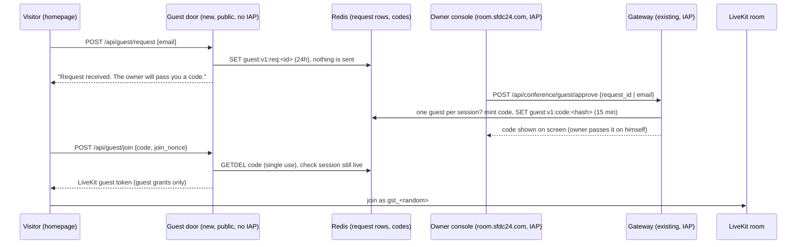

# Guest door for the Workshop conference: design (draft for review, no code)

Status: DESIGN ONLY. Written Sat 2026-10-24 00:40 ET by Grok Bot. No PRs, no deploys, nothing sent.
Grounded in: sfdc-24/conference main @5cca140 (read via `gh api`, not cloned), sfdc-24/sfdc24-site origin/main @d009c5e.

## 1. What the owner asked (Sat 00:14-00:17 ET)
> "users should be able to drop their email address [on the homepage] and get a code so they can join in conference, only upon my approval"
> "have it so that I can ask one more person to be in the conference with me"
> "my entry is with abdus@sfdc24.com"

## 2. Flow

## 3. Data (Redis, `guest:v1:` prefix, matching the chair's v1 colon-prefix rule in chair/conf_chair/redis_state.py)
| Key | Value | TTL |
|---|---|---|
| `guest:v1:req:<req_id>` | {email_lower, ts, ip_hash, status: pending/approved/declined} | 24 h |
| `guest:v1:req_by_email:<sha256(email)>` | req_id (dedupe) | 24 h |
| `guest:v1:code:<sha256(code)>` | {req_id, room, session_epoch} (code never stored in clear) | 15 min |
| `guest:v1:seat:<room>` | req_id (one human guest per session, SET NX) | until session deadline |
| `guest:v1:rl:ip:<ip_hash>` / `rl:email:<hash>` | counters | 1 h |
Redis is an ephemeral accelerator, not the system of record (same rule as redis_state.py). Approvals are also logged as ids only.

## 4. Routes and token grants
Existing (seen in gateway/conf_gateway/app.py): `POST /api/conference/join` -> `join()`; `guarded()` (JSON only, Origin in `config.public_origins`, `owners.verify()` from owner.py = IAP assertion + OWNER_EMAILS); `Nonces.use()` single-use join nonces (10 min, in-memory); `tokens.join_token()` (owner grants: mic + screen share, no data); `Signer` ES256.
New, owner side (inside the IAP gateway, behind `guarded()`):
- `POST /api/conference/guest/approve` {request_id} or {email} (owner-typed email = approval implied). Returns {code, expires_at}. Refuses if a seat is already held for the current `rooms.current()` session.
- `POST /api/conference/guest/revoke` {room, session_epoch}: frees the seat, kicks the guest identity.
New, public side (the guest cannot pass IAP, so these CANNOT live on the IAP service; see 9.3):
- `POST /api/guest/request` {email}: writes a request row only.
- `POST /api/guest/join` {code, join_nonce}: returns {livekit_url, room, identity, join_token, join_expires_at}. No broker token, no receipt, no session_epoch-bearing authority.
Guest LiveKit grants (new `tokens.guest_token()`): room_join for that one room, can_subscribe=True, can_publish=True with sources ["microphone"] only, can_publish_data=False, no screen share, identity `gst_<random>`, name "Guest", TTL = min(10 min join, session deadline). The guest hears and sees what is published (owner screen only if he shares); no canvas write (no broker/chalk scope), no Salesforce, no client data. Note: the canvas bucket file rooms/workshop.json is already public-read, so the canvas is not secret.

## 5. Abuse limits
- Request: 5/hour per IP hash, 3/day per email, max 50 pending rows; email syntax + length 254; honeypot field. No mail sent, so no spam relay.
- Approve: owner only (IAP); one seat per session (`SET NX`); a second approve returns 409 until revoke.
- Code: 8 chars from a 31-char alphabet (~40 bits), 15 min TTL, `GETDEL` = single use, 5 wrong tries per IP per 15 min then 429.
- Join: reuse the `Nonces` pattern for join_nonce; code bound to room + session_epoch, dies with the session (same "nothing outlives the session" rule as `tokens._until()`).
- `rooms.MAX_PARTICIPANTS = 4` (owner, chair, one reconnect each) must become 6 for owner + chair + guest + reconnects; chair must treat `gst_` as listener-speaker, never as owner (owner commands stay `conf.owner` packets from the server only).

## 6. Reuse vs new
Reuse: `guarded()`, `OwnerCheck`, `Nonces`, `Window` rate limiter, `rooms.current()`/`admission()` lock, `join_ttl()`, `_json()` no-store, the chair's Redis connection pattern (two switches CONF_REDIS_CONNECT / CONF_REDIS_ENABLED).
New: guest routes, `guest_token()`, Redis client in the gateway (gateway has no Redis today: requirements.txt has no redis package and deploy.sh sets no VPC egress), public guest-door service, homepage email field, console "Guests" panel (approve / show code / revoke), guest join page.

## 7. Files to touch
sfdc-24/conference: `gateway/conf_gateway/app.py` (approve/revoke routes + public routes behind a flag), new `gateway/conf_gateway/guests.py` (rows, codes, seat), `tokens.py` (`guest_token`), `rooms.py` (MAX_PARTICIPANTS), `main.py` (REDIS settings, GUEST_DOOR flag), `deploy.sh` (second service + room.sfdc24.com in PUBLIC_ORIGINS), `requirements.txt` (redis), `console/app.js` + `console/index.html` (Guests panel), chair (treat `gst_` identity), `docs/CONF-LINE-ARCHITECTURE.md` (has no guest rules today; add them).
sfdc-24/sfdc24-site: `index.html` (email field), new `assets/guest-request.js`, new `/conference/guest/` join page, `conference/index.html` + `CONFERENCES_BACKEND_NEEDS.md` (gate text changes from "closed until VERIFY and GO" only after owner GO), CSP connect-src for the door origin.

## 8. Tests to add
conference: `gateway/tests/test_guests.py`: request writes a row and sends nothing; non-owner approve 403; second approve 409; code single use (2nd join 409); expired code 410; code for old epoch refused; guest token grants (mic only, no data, no screen, one room, ttl <= deadline); rate limits 429; cross-origin refused. Add guest cases to `test_gateway_adversarial.py`.
site: update `tests/conferences_invite.spec.cjs` / `conferences_enter.spec.cjs` (today they assert NO invite and NO enter: `#conference-invite` count 0, `#conference-enter` count 0, contact text abdus@sfdc24.com) only after GO; new `tests/homepage_guest_request.spec.cjs`; keep `tests/test_conference_page.py` "Guests stay closed" until GO; 206,000-byte homepage budget must still pass (trim, never raise).

## 9. Open owner decisions
1. Code delivery: show code to owner (default, no new service) vs email it (needs a mail service = new spend/secret).
2. Guest-door hosting: Cloud Run IAP covers the whole `conference-gateway` service (`--iap --no-allow-unauthenticated`), so public routes need a second, unauthenticated Cloud Run service (or a public path in an existing non-IAP service). That is new IAM (allUsers invoker) and small spend, which the plan row said to avoid. He must pick.
3. Redis reach from the gateway (VPC egress) vs Firestore for rows (gateway already lives in a GCP project; chair uses Firestore checkpoints).
4. Gate text: when to replace "Guests stay closed until the owner records VERIFY and GO".
5. PR cap: sfdc24-site has 3 open (345, 357, 363), so no new site PR until one lands; sfdc-24/conference has 30 open PRs, far over cap; consolidate first.

## 10. Estimate
Gateway + guests.py + tests: ~1 day. Console panel: ~0.5 day. Site field + join page + specs: ~0.5 day. Guest-door service + IAM + origins deploy: ~0.5 day after decision 2. Reviews (Gemini design+code, Aya) + deploy by claude-mobile on PASS: ~0.5 day. Total ~3 working days.

## 11. Text invite and dial-out on the EXISTING rail (rev 3, Sat 2026-10-24 ~02:15 ET; owner ruling 01:31 ET: "we already got a canadian number and its all part of this project")

Design only; nothing sent, called, bought, granted or moved. Rule: the owner sees the exact text or number and taps before anything leaves. Rev 3 closes the project question, makes the 15-minute end LiveKit-enforced, and records two WhatsApp/SMS limits found in the existing code.

### What already exists (looked up, not asked)
Labels: **BOARD** = stated on the fleet board by the agent that read it, with its time; **BOX** = read tonight in files on the Grok box; nothing below was re-read live in LiveKit, Telnyx or Secret Manager tonight (Grok has no cloud credentials in use for this pass).
- LiveKit outbound trunk `ST_...` named `telnyx-lou-outbound`, via sip.telnyx.com, caller ID = the existing Canadian Telnyx long code. BOARD (LiveKit console read, 2026-10-16 22:35 ET) and BOX (`lou_call.py`, `rehearsal_call.py` use that trunk id).
- Calls already placed on it: lou-outbound-* and room C8J98G calls with `SCL_...` call ids, 2026-10-16 ET. BOX (`logs/rehearsal_log.jsonl`).
- SIP host `3p1vbksold1.sip.livekit.cloud`. BOX.
- Telnyx messaging profile `converspan-lou`, enabled, destinations CA and US, no 10DLC campaign (so US SMS is not cleared; Canadian is the target). BOX (`logs/messaging-readiness-2026-10-16.json`). Three SMS from that number were accepted by Telnyx (status `queued`) on 2026-10-16. BOX (`logs/sms_log.jsonl`); handset delivery is not in the log.
- WhatsApp: the Meta Cloud API sender behind the Pipedream workflow (`WA_PHONE_NUMBER_ID`). Blackboard `scripts/wa_send.py` / `wa_notify.py`.

### Same LiveKit project? YES (board-attested, re-check is one boolean)
- The gateway reads Secret Manager `LIVEKIT_URL:latest` in GCP project sfdc24 (conference `gateway/deploy.sh`, `--set-secrets`). The chair reads the same secret.
- claude-code-cli, 2026-10-17 10:50 ET (board, PR 421 note): that secret's host is the `blackboard-...livekit.cloud` host of LiveKit project Blackboard = **p_3p1vbksold1**, the project that holds Lou's outbound trunk, number and dispatch rule.
- So: **no trunk on another project, no move.** The gateway passes the trunk id as a non-secret env var `CONF_SIP_TRUNK_ID`. The existing `LIVEKIT_API_KEY/SECRET` already mint SIP admin/call grants through `livekit-api` (pinned 1.2.1 / protocol 1.1.27, which has `CreateSIPParticipantRequest` with `ringing_timeout`, `max_call_duration`, `hide_phone_number`).
- Before deploy, claude-code-cli re-checks booleans only: the `LIVEKIT_URL` latest version's host still ends `.livekit.cloud` with the Blackboard subdomain, and `ListSIPOutboundTrunk` returns the trunk id. If either is false, the smaller fix is one outbound trunk on the conference project with the existing Telnyx SIP credentials (moving the conference = redeploying gateway and chair on new keys, larger). Both would need the owner's go.

### Dial-out (claude-code-cli builds console/ + gateway/, one PR)
- Console, owner only (IAP-verified owner session): **Call a number** field. Confirm sheet shows "Call +1 ••• •••1234 into this room?" and the call goes only on **Call**. One tap = at most one call (button disabled until the call ends or fails).
- `POST /api/conference/dial {e164}` behind IAP + `guarded()` (owner check, origin check). Accept only `^\+1[2-9]\d{2}[2-9]\d{6}$` with a Canadian area-code allowlist (US only if the owner later asks). Refuse if the room's one guest seat is held (`SET NX guest:v1:seat:<room>`, same key as section 3) or a call is already live in the room.
- Gateway call, same shape as `lou_call.py`: `CreateSIPParticipant(sip_trunk_id=CONF_SIP_TRUNK_ID, sip_call_to=e164, room_name=<owner's current room>, participant_identity="phone_"+random, participant_name="Phone guest", ringing_timeout=45 s, max_call_duration=15 min, hide_phone_number=True, wait_until_answered=False)`. No agent dispatch: the callee joins the live conference room, audio only.
- Chair and console treat `phone_` like `gst_`: guest, audio only, never owner, never gets data/screen permissions.
- End: **Hang up** = `RemoveParticipant`; LiveKit ends the call at 15 min (`max_call_duration`); the call also ends when the room session ends. Re-dialling is a new owner tap.
- Caps: 1 live call per room, 1 per 3 min, 5 per ET day (Redis counters, ids only). Number and audio never logged; the board gets `{room, call_id, outcome}`.
- Credentials: none new. Only the existing `LIVEKIT_*` already on the gateway; Telnyx SIP credentials stay in the LiveKit trunk.

### Text invite (Grok design; built in the same gateway/console PR or right after)
1. On approval (or when the owner types the guest's phone), the gateway returns `{code, expires_at, invite_text}` from one fixed template: "Abdus invites you to a call on sfdc24.com. Code <CODE>, valid 15 min: https://www.sfdc24.com/conference/guest/". No client names, no free text.
2. Console shows the text read-only with **Send by SMS**, **Send by WhatsApp**, **Copy**. Nothing goes out without that tap.
3. `POST /api/conference/guest/send {request_id, channel, text_sha256}` behind IAP + `guarded()`. Server re-renders the template, refuses on a hash mismatch, a second send per approval (`SET NX guest:v1:sent:<req_id>`), more than 5 a day, or a non-Canadian number.
4. **SMS** (preferred for Canadian numbers): Telnyx `POST /v2/messages` from the existing Canadian number on profile `converspan-lou`, `send_link.py`'s caps ported. Change from today: `send_link.py` is locked to an allowlist of the owner only; the gateway version sends only to the phone on the approved request.
5. **WhatsApp** limit: Meta accepts free-form text only inside 24 h of the recipient's last message to the business number, and the board (2026-10-04) says no template is approved for it; `wa_send.py` is also locked to the owner's number. So WhatsApp to a new guest works only if the guest messaged the SFDC24 WhatsApp first, or after a utility template is approved. Until then the console shows WhatsApp as a `wa.me` link that opens the owner's own WhatsApp with the text filled in (his phone sends; no server send).
6. Secret placement: the gateway SA needs read on the EXISTING Telnyx API key (in Secret Manager if it is there; if it only lives in local env files, storing it is a new secret = owner go). That grant is IAM, stated on the board, done only on the owner's go.
Zero-setup fallback that can ship first: **Text it** (`sms:` link) and **WhatsApp it** (`wa.me` link) open the owner's own phone with the text filled in.

### Tests
- Gateway: dial refused for non-owner, bad origin, non-Canadian or malformed number, held seat, live call, inside 3 min, over 5/day; CreateSIPParticipant arguments asserted exactly (trunk id from env, 15 min cap, hide_phone_number); hang-up removes only `phone_` identities.
- Send: refused on hash mismatch, twice, over cap, wrong channel; template has no client names; logs hold hashes only.
- Console: what is shown equals what is sent; the confirm step is required; button disabled during a call.

### Left for the owner (not asked tonight; for the morning list)
- IAM grant: gateway SA read on the existing Telnyx key (and whether that key is in Secret Manager at all).
- WhatsApp template approval if he wants server-sent WhatsApp to new guests.
- Deploy of the dial-out PR after Aya passes it (standing go covers the exact passed head only if he counts this as a conference piece).
- Spend cap stands; calls/texts cost Telnyx per minute/part plus LiveKit SIP minutes.
