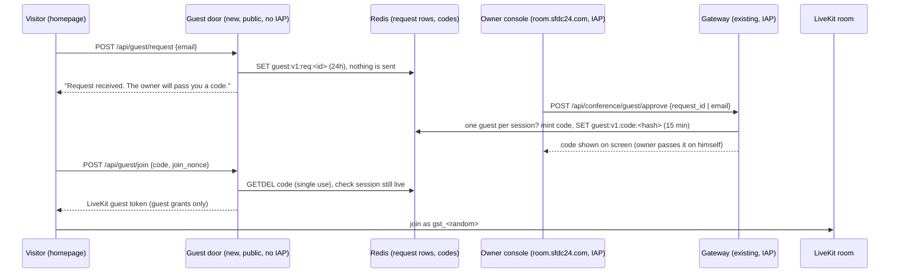

# Guest door for the Workshop conference: design (draft for review, no code)

Status: DESIGN ONLY. Written Sat 2026-10-24 00:40 ET by Grok Bot. No PRs, no deploys, nothing sent.
Grounded in: sfdc-24/conference main @5cca140 (read via `gh api`, not cloned), sfdc-24/sfdc24-site origin/main @d009c5e.

## 1. What the owner asked (Sat 00:14-00:17 ET)
> "users should be able to drop their email address [on the homepage] and get a code so they can join in conference, only upon my approval"
> "have it so that I can ask one more person to be in the conference with me"
> "my entry is with abdus@sfdc24.com"

## 2. Flow

## 3. Data (Redis, `guest:v1:` prefix, matching the chair's v1 colon-prefix rule in chair/conf_chair/redis_state.py)
| Key | Value | TTL |
|---|---|---|
| `guest:v1:req:<req_id>` | {email_lower, ts, ip_hash, status: pending/approved/declined} | 24 h |
| `guest:v1:req_by_email:<sha256(email)>` | req_id (dedupe) | 24 h |
| `guest:v1:code:<sha256(code)>` | {req_id, room, session_epoch} (code never stored in clear) | 15 min |
| `guest:v1:seat:<room>` | req_id (one human guest per session, SET NX) | until session deadline |
| `guest:v1:rl:ip:<ip_hash>` / `rl:email:<hash>` | counters | 1 h |
Redis is an ephemeral accelerator, not the system of record (same rule as redis_state.py). Approvals are also logged as ids only.

## 4. Routes and token grants
Existing (seen in gateway/conf_gateway/app.py): `POST /api/conference/join` -> `join()`; `guarded()` (JSON only, Origin in `config.public_origins`, `owners.verify()` from owner.py = IAP assertion + OWNER_EMAILS); `Nonces.use()` single-use join nonces (10 min, in-memory); `tokens.join_token()` (owner grants: mic + screen share, no data); `Signer` ES256.
New, owner side (inside the IAP gateway, behind `guarded()`):
- `POST /api/conference/guest/approve` {request_id} or {email} (owner-typed email = approval implied). Returns {code, expires_at}. Refuses if a seat is already held for the current `rooms.current()` session.
- `POST /api/conference/guest/revoke` {room, session_epoch}: frees the seat, kicks the guest identity.
New, public side (the guest cannot pass IAP, so these CANNOT live on the IAP service; see 9.3):
- `POST /api/guest/request` {email}: writes a request row only.
- `POST /api/guest/join` {code, join_nonce}: returns {livekit_url, room, identity, join_token, join_expires_at}. No broker token, no receipt, no session_epoch-bearing authority.
Guest LiveKit grants (new `tokens.guest_token()`): room_join for that one room, can_subscribe=True, can_publish=True with sources ["microphone"] only, can_publish_data=False, no screen share, identity `gst_<random>`, name "Guest", TTL = min(10 min join, session deadline). The guest hears and sees what is published (owner screen only if he shares); no canvas write (no broker/chalk scope), no Salesforce, no client data. Note: the canvas bucket file rooms/workshop.json is already public-read, so the canvas is not secret.

## 5. Abuse limits
- Request: 5/hour per IP hash, 3/day per email, max 50 pending rows; email syntax + length 254; honeypot field. No mail sent, so no spam relay.
- Approve: owner only (IAP); one seat per session (`SET NX`); a second approve returns 409 until revoke.
- Code: 8 chars from a 31-char alphabet (~40 bits), 15 min TTL, `GETDEL` = single use, 5 wrong tries per IP per 15 min then 429.
- Join: reuse the `Nonces` pattern for join_nonce; code bound to room + session_epoch, dies with the session (same "nothing outlives the session" rule as `tokens._until()`).
- `rooms.MAX_PARTICIPANTS = 4` (owner, chair, one reconnect each) must become 6 for owner + chair + guest + reconnects; chair must treat `gst_` as listener-speaker, never as owner (owner commands stay `conf.owner` packets from the server only).

## 6. Reuse vs new
Reuse: `guarded()`, `OwnerCheck`, `Nonces`, `Window` rate limiter, `rooms.current()`/`admission()` lock, `join_ttl()`, `_json()` no-store, the chair's Redis connection pattern (two switches CONF_REDIS_CONNECT / CONF_REDIS_ENABLED).
New: guest routes, `guest_token()`, Redis client in the gateway (gateway has no Redis today: requirements.txt has no redis package and deploy.sh sets no VPC egress), public guest-door service, homepage email field, console "Guests" panel (approve / show code / revoke), guest join page.

## 7. Files to touch
sfdc-24/conference: `gateway/conf_gateway/app.py` (approve/revoke routes + public routes behind a flag), new `gateway/conf_gateway/guests.py` (rows, codes, seat), `tokens.py` (`guest_token`), `rooms.py` (MAX_PARTICIPANTS), `main.py` (REDIS settings, GUEST_DOOR flag), `deploy.sh` (second service + room.sfdc24.com in PUBLIC_ORIGINS), `requirements.txt` (redis), `console/app.js` + `console/index.html` (Guests panel), chair (treat `gst_` identity), `docs/CONF-LINE-ARCHITECTURE.md` (has no guest rules today; add them).
sfdc-24/sfdc24-site: `index.html` (email field), new `assets/guest-request.js`, new `/conference/guest/` join page, `conference/index.html` + `CONFERENCES_BACKEND_NEEDS.md` (gate text changes from "closed until VERIFY and GO" only after owner GO), CSP connect-src for the door origin.

## 8. Tests to add
conference: `gateway/tests/test_guests.py`: request writes a row and sends nothing; non-owner approve 403; second approve 409; code single use (2nd join 409); expired code 410; code for old epoch refused; guest token grants (mic only, no data, no screen, one room, ttl <= deadline); rate limits 429; cross-origin refused. Add guest cases to `test_gateway_adversarial.py`.
site: update `tests/conferences_invite.spec.cjs` / `conferences_enter.spec.cjs` (today they assert NO invite and NO enter: `#conference-invite` count 0, `#conference-enter` count 0, contact text abdus@sfdc24.com) only after GO; new `tests/homepage_guest_request.spec.cjs`; keep `tests/test_conference_page.py` "Guests stay closed" until GO; 206,000-byte homepage budget must still pass (trim, never raise).

## 9. Open owner decisions
1. Code delivery: show code to owner (default, no new service) vs email it (needs a mail service = new spend/secret).
2. Guest-door hosting: Cloud Run IAP covers the whole `conference-gateway` service (`--iap --no-allow-unauthenticated`), so public routes need a second, unauthenticated Cloud Run service (or a public path in an existing non-IAP service). That is new IAM (allUsers invoker) and small spend, which the plan row said to avoid. He must pick.
3. Redis reach from the gateway (VPC egress) vs Firestore for rows (gateway already lives in a GCP project; chair uses Firestore checkpoints).
4. Gate text: when to replace "Guests stay closed until the owner records VERIFY and GO".
5. PR cap: sfdc24-site has 3 open (345, 357, 363), so no new site PR until one lands; sfdc-24/conference has 30 open PRs, far over cap; consolidate first.

## 10. Estimate
Gateway + guests.py + tests: ~1 day. Console panel: ~0.5 day. Site field + join page + specs: ~0.5 day. Guest-door service + IAM + origins deploy: ~0.5 day after decision 2. Reviews (Gemini design+code, Aya) + deploy by claude-mobile on PASS: ~0.5 day. Total ~3 working days.

## 11. Text invite (SMS or WhatsApp): design only (added Sat 2026-10-24 01:55 ET, for CLAUDE-MOBILE-DISPATCH-EXTENSIONS-20261024T0530Z)

Owner ask 01:25 ET: "sending text invite to join conference". Rule: no message goes out without his tap, and he sees the exact text before it sends.

### Options, cheapest first
| Option | How the text leaves | New secret / IAM / spend | Cost (public price pages, checked 2026-10-24) |
|---|---|---|---|
| **A. Send from his own phone (recommended start)** | After approval, the owner console shows the code and a ready message with **Text it** (`sms:<number>?body=...`), **WhatsApp it** (`https://wa.me/<number>?text=...`) and **Copy**. His phone's own Messages or WhatsApp opens with the text filled in, and he presses Send. | None. No provider, no number, no key. | $0 beyond his own plan |
| B. Provider SMS from the gateway (Telnyx) | Gateway calls the provider API after the owner taps Send in the console | One API key in Secret Manager (gateway SA only), one Canadian long-code number | About US$0.004 per part plus carrier passthrough; number from US$1.00/mo plus US$0.10/mo for SMS (telnyx.com/pricing/messaging, /pricing/numbers) |
| C. Provider SMS (Twilio) | Same as B | Same as B | US$0.0083 per segment plus Canadian carrier fee about US$0.0064-0.0087; long code US$1.15/mo (twilio.com/en-us/sms/pricing/ca) |
| D. WhatsApp Business API (via a BSP) | Template message through the "single outbox" in CONF-LINE-ARCHITECTURE.md line 200 | Meta business verification, an approved template, and BSP credentials | Meta per-conversation rate (not priced here); several days to get templates approved |

At one invite per session, B and C cost cents a month plus the number. The real cost is a new secret, a new outbound path, and A2P registration for the sender, which takes 2-3 business days per Telnyx's sender-type docs.
Note: the Grok box has a /workspace/telnyx folder from the earlier Lou rehearsals (creds.env, post_call_sms.py). Lou stays unshipped. Reusing that account for B is an owner decision, and nothing here reads or moves those credentials.

### Flow (option A, fits section 2 with no new service)
1. Owner approves a request, or types a guest's phone himself (approval implied): `POST /api/conference/guest/approve {request_id | phone}`, IAP plus `guarded()`.
2. The gateway returns `{code, expires_at, invite_text}`. invite_text is built server-side from a fixed template: "Abdus invites you to a call on sfdc24.com. Code <CODE>, valid 15 min: https://www.sfdc24.com/conference/guest/". It holds no client names and no other personal data.
3. The console shows the text read-only, then the three buttons. The phone number never leaves the owner's browser for A: the console builds the `sms:`/`wa.me` link locally, and the gateway stores only `sha256(phone)` for rate limits.
4. Nothing is sent by any server. The board gets an ids-only row: `guest invite shown, req=<id>, channel=sms|whatsapp|copy`.

### For B/C later (only after the owner's go)
- `POST /api/conference/guest/send {request_id, channel}` behind IAP plus `guarded()`. The console sends only after the owner taps **Send** on the text shown. The server re-renders the same template and refuses if it differs from the hash the console showed.
- One send per approval (Redis `SET NX guest:v1:sent:<req_id>`), at most 5 sends a day across the room, E.164 checks, and Canadian and US numbers only.
- The key lives in Secret Manager. Only the gateway service account can read it. It is never logged, and the message body is logged as a hash only.
- Provider delivery receipts go to the board as ids only.

### Tests to add
Console: the text shown equals the text sent, `sms:`/`wa.me` links are URL-encoded, and no fetch carries the phone. Gateway: approve returns invite_text from the template only, and B/C send is refused without a prior approve, twice for one approval, on a template-hash mismatch, or for a non-CA/US number.

### Owner decisions
1. Start with A (no spend)? Recommended.
2. If B/C: which provider, buy a Canadian number (about US$1-1.15/mo), and reuse the old Telnyx account or open a new one.
3. WhatsApp Business (D): defer. A already opens WhatsApp on his phone for free.
